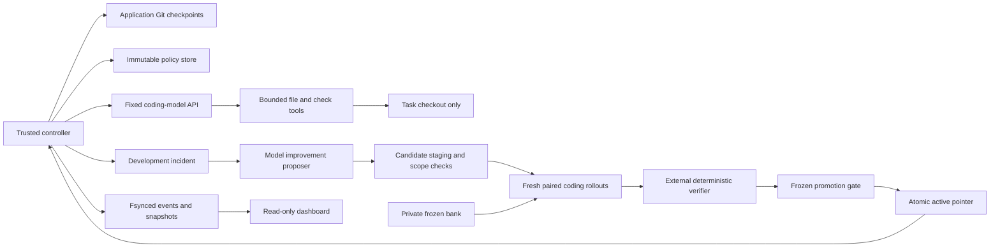

# Controller boundaries

The model is remote; its only local tools are the bounded capabilities the controller exposes. It cannot issue controller commands or mutate the active pointer. Each coding attempt is pinned to a policy content hash. A policy is a parent hash plus content; its exact bytes are checked before use and after evaluation. Activation records bind both candidate hash and current incumbent. Hashes detect accidental corruption; a trusted host administrator can still rewrite local artifacts.

In Docker mode, development checks and the public RPC service process see only the task checkout, a read-only task contract, the public runtime image and disposable temporary storage. Expected responses are compared outside the container. The API credential never enters a task container. The local fallback has no process/filesystem isolation and cannot pass a promotion gate.

A Git commit alone is not a checkpoint. The application snapshot also records dependency-ordered verified milestones, trusted check results, unresolved objectives, the fixture recreation strategy and failures. Code that fails remains committed; regressions are retained on diagnostic branches before source/fixture restoration. Independent verification determines progress. The controller never treats an agent's “done” message as acceptance.

Each held-out pair starts with the same deterministic initial Git commit. The synthetic fixture commit timestamp is fixed for reproducibility; actual attempt timestamps are stored in the controller journal. Source commits and immutable policy versions are different identifiers. All evaluation retries have their own attempt record; scored rows identify the final infrastructure try. A block is consumed before the first task is loaded for runtime evaluation. Interrupted or imbalanced comparisons cannot activate a policy.

Promotion is allowed only between episodes under the single controller lock. The active-pointer change is atomic with a write-ahead journal intent. Resume reconciles an intent interrupted after pointer replacement. A regression canary can trigger conservative policy rollback; this trigger alone is not causal evidence against the policy. Policy rollback leaves application code intact. Application rollback separately restores a verified commit and rebuilds disposable fixtures.

The dashboard reads snapshots and journal records, never model assertions. It exposes no writes and does not serve the private bank or raw transcripts. It distinguishes live application work, promotion, audit, development checks and labeled synthetic controls.
